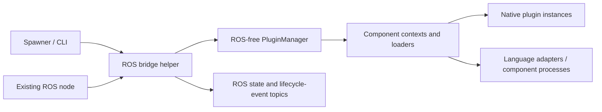

# Managed plugin lifecycle and ROS node helpers

Status: feature proposal, ready for design review. No implementation is included.
Date: 2026-11-04.
Development sequence: [development-plan.md](development-plan.md).

## Purpose

Let a Python or C++ application manage named workspace component instances:
load them, initialize them, activate/deactivate them, inspect their state, and
unload or replace them while the application keeps running. ROS nodes access
the same behavior through a helper constructed with their node and a manager.
A spawner exposes these operations from the CLI and ROS launch files.

This follows the usability of ros2_control's manager and spawner, while using
RPP component descriptions, plugin types, parameters, and language adapters.

## Confirmed requirements

- Provide equivalent Python and C++ helpers.
- A ROS-free manager owns plugin instances, resources, state, and transitions.
- A separate ROS helper receives an existing ROS node as a constructor
  argument, creates services/topics, and bridges behavior to that manager.
- Manage workspace component instances, including parameters and subcomponents.
- Preserve native hosting and adapted hosting, including mixed-language trees.
- Provide explicit `on_activate()` and `on_deactivate()` plugin callbacks.
- Let each plugin type declare a Cap'n Proto handover-state struct. Deactivation
  can export a typed snapshot and activation can consume it, including when
  switching between different implementations of the same plugin type.
- Use an optional `lifecycleState` annotation to associate a plugin type with
  its handover struct. Without it, activation/deactivation still exist and
  accept no state arguments; the plugin type has no handover payload.
- Load and unload components dynamically through a spawner/CLI.
- Reconfiguration and source updates replace instances: deactivate, unload,
  load again, initialize, and optionally reactivate. Never patch a live object.
- Keep ROS dependencies out of the core RPP manager and plugin contract.
- Backward compatibility is not a requirement. Replace old lifecycle APIs and
  update callers, generated code, and plugins together; do not add legacy shims.

## Architecture and ownership



Proposed API shape, not final implementation syntax:

```python
manager = PluginManager(workspace=workspace)
bridge = RosPluginManagerBridge(node, manager)

manager.load("controller", component="vehicle_controller")
manager.configure("controller")
manager.activate("controller")
manager.with_active("controller", lambda plugin: plugin.step(...))
```

```cpp
rpp::PluginManager manager(workspace);
rpp_ros2::PluginManagerBridge bridge(node, manager);

manager.load("controller", component_ref);
manager.configure("controller");
manager.activate("controller");
manager.with_active<Controller>("controller", [](Controller & plugin) {
  plugin.step(/* domain arguments */);
});
```

The manager has no ROS node, executor, services, or topics. It can be tested and
used by non-ROS applications. The bridge translates requests and results,
registers ROS endpoints under the supplied node's namespace, and publishes
manager state changes. It must not implement another lifecycle state machine.

Implementation responsibilities are kept separate so the public manager reuses
existing machinery rather than duplicating it:

| Component | Responsibility |
| --- | --- |
| `PluginManager` (planned public API) | Named entries, lifecycle state, transition policy, guarded access, and coordinated shutdown/replacement. |
| `ComponentContextBuilder` | Construct a tree and prepare its transports; transfer ownership on success and roll back a failed build. |
| `ComponentContext` | Hold parameters, subcomponents, instances, and owned runtime handles; perform existing tree callback traversal. Plugins use its parameter/component/logger/clock accessors. |
| `ExternalComponentProcess` | Own one external host process, client connections, and the internal RPC executor. |
| `RppServerHost` | Serve capabilities and runtime requests inside the hosting process; it does not launch that process or decide plugin lifecycle transitions. |

Only the manager introduces lifecycle state and application-call gates. It
delegates traversal to the existing context and construction to the existing
builder. No separate session object is added. Synchronous users should not
assemble process owners, adapters, or server hosts themselves.

The application owns the node, manager, and bridge. Bridge closure stops new
ROS requests and releases its services/topics. Manager shutdown performs
lifecycle teardown. Their destruction order and explicit `close`/`shutdown`
methods must prevent callbacks from accessing destroyed objects.

A managed entry has an instance name, workspace/component reference, plugin
identity (`library::Plugin`), language, lifecycle state, current generation,
source/artifact revision, and last operation result. Multiple named instances
may use the same plugin implementation with separate parameter state.

## Lifecycle contract

Proposed stable states:

| State | Meaning |
| --- | --- |
| `UNLOADED` | A configured manager entry has no runtime instance. |
| `UNCONFIGURED` | Its object/context exists; initialization has not completed. |
| `INACTIVE` | Initialized and ready; application calls are disabled. |
| `ACTIVE` | Initialized, activated, and available for guarded application calls. |
| `ERROR` | A transition failed or safe teardown could not complete; calls are blocked. |

Operations also expose an in-progress transition, separately from the last
stable state. Listing a loading component must not claim it is already active.

| Operation | Preconditions | Successful result | Plugin callback |
| --- | --- | --- | --- |
| `load` | `UNLOADED` | `UNCONFIGURED` | Construction only. |
| `configure` | `UNCONFIGURED` | `INACTIVE` | `on_configure(context)` |
| `activate` | `INACTIVE` | `ACTIVE` | `on_activate(state=None)` |
| `deactivate` | `ACTIVE` | `INACTIVE` | `on_deactivate()`, returning a result and optional typed state. |
| `cleanup` | `INACTIVE` | `UNCONFIGURED` | `on_cleanup()` |
| `unload` | Any safely stoppable loaded state | `UNLOADED` | Deactivate if active, cleanup if needed, destroy. |

`on_configure` is the proposed explicit initialization callback. It receives
the existing component context and allocates/configures resources without
starting active work. `on_activate` starts active work. `on_deactivate` stops
that work and brings outputs/resources to the plugin's documented inactive
condition. `on_cleanup` releases configuration resources and must tolerate
partially completed initialization. Destruction releases the instance itself.

Lifecycle results carry an RPP `CallbackResult` with success/failure and a
diagnostic message. `require_success(operation)` is an instance method on the
result: `result.require_success("on_activate")`. It returns normally on success
and raises a lifecycle error containing the operation and reason on failure.
There is no separate free-standing `require_success` helper. In C++, the method
is `const`; Python uses an ordinary instance method, not a `@classmethod`.
Deactivation wraps the result in `DeactivationResult<State>` with
an optional handover snapshot. Callbacks are synchronous in the initial contract; manager
operations may expose an asynchronous facade without changing callback order.
An exception is converted to a failed transition. Any
failed lifecycle callback puts the affected entry in `ERROR`, closes its call
gate, and records the failed phase; the manager never reports success early.
Cleanup of other independent entries continues during manager shutdown.

No callback is rerun for a duplicate request already completed with the same
operation ID. Asking to activate an already active entry, or deactivate an
already inactive entry, succeeds without invoking the callback again. Other
invalid transitions return an explicit invalid-state result.

### Adopt the new contract directly

`on_configure(context)` replaces the old `initialize(context)` plugin callback.
Update contexts, component servers, generated plugin bases, examples, tests,
and applications to use the new lifecycle directly. There is no legacy
initializer fallback or automatic interpretation of old callback return values.
Move active background work into activation and stop it during deactivation.

`reset()` remains an algorithm-specific operation, not a lifecycle transition.
Rebuild all C++ plugins/adapters against the new interface and regenerate
protocol bindings together. Loading artifacts built against a different
runtime/ABI must fail explicitly; supporting old binaries is outside scope.

## Plugin-type-specific state handover

Lifecycle state (`ACTIVE`, `INACTIVE`, etc.) and application handover state are
different concepts. The latter is an owned value defined by the plugin type,
such as a localization estimate that several localization implementations can
exchange. It is not an arbitrary Python object or a plugin's private memory.

Agreed state binding, to be implemented after the callback contract tests:

```capnp
# Fragment: normal file ID and imports are omitted.
struct LocalizationState {
  timestampNs @0 :Int64;
  frameId @1 :Text;
  pose @2 :Msgs.Pose3D;
  covariance @3 :List(Float64);
}

interface Localization
    $Anot.plugin("Localization")
    $Anot.lifecycleState("LocalizationState") {
  estimate @0 () -> (state :LocalizationState);
}
```

The optional annotation determines the typed callback signatures, state
serialization, and validation; it does not enable or disable lifecycle support.
Schema parsing and native callback generation now support a non-generic struct
declared in the same schema file. The plugin-type payload records the struct's
name and source schema ID. Imported or nested state bindings are rejected in
this first implementation. Adapted serialization and revision checks remain
planned. A plugin type without the annotation exposes argument-free
`on_activate()` and `on_deactivate()` callbacks with no application-state payload.
Use existing struct generation: Python receives a validated dataclass, C++ a
corresponding generated owning value type, with Cap'n Proto serialization for
adapted calls. The struct remains defined once in the plugin-type schema.

Illustrative callback signatures for a localization implementation:

```python
def on_activate(self, state: LocalizationState | None = None) -> CallbackResult:
    ...

def on_deactivate(self) -> DeactivationResult[LocalizationState]:
    ...
```

```cpp
CallbackResult on_activate(const std::optional<LocalizationState> & state) override;
DeactivationResult<LocalizationState> on_deactivate() override;
```

The generated plugin-type base exposes typed callbacks. The generic manager
uses an internal schema-aware dispatch bridge; it must not force every plugin
type to share one application-state class. In C++, typed callbacks and internal
type-erased dispatch use distinct entry points so virtual overrides are valid.

The native C++ callback base is `LifecyclePlugin<State>` for stateful plugins and
`LifecyclePlugin<void>` for stateless plugins. Both dispatch through `Plugin` using
`activate_state` and `deactivate_state`. Python uses `Plugin` with the state type
declared by `HANDOVER_STATE_TYPE`. Dispatch copies handover values at both
boundaries; C++ state types must own their data. Python dispatch raises
`LifecycleError` for callback failures, while C++ returns a failed result that
the caller can check with `require_success()`.

`None`/`std::nullopt` explicitly means cold activation without a prior estimate;
it must not be represented by an accidentally all-zero estimate. A plugin can
reject cold activation if its contract requires an initial state. Stateless
plugin types declare no handover schema and use the default no-state callbacks.

On deactivation, stop background updates and capture a consistent final snapshot
before cleanup/destruction. Return both the callback result and an optional
snapshot; a failed deactivation's payload is never handed to another plugin.
The manager owns a copy or serialized value, never a reference/reader whose
storage belongs to the old instance or process.

### Switching localization implementations

```python
manager.switch_plugins("ekf", "particle_filter", transfer_state=True)
```

1. Resolve and prepare the target, leaving it configured and inactive. Check
   plugin-type and handover-schema compatibility before stopping the source.
2. Block new source calls, drain existing calls, and invoke its deactivation.
3. Validate and retain the returned `LocalizationState`. Pass that snapshot to
   the target's `on_activate`; do not run a separate snapshot callback later.
4. Only after activation succeeds, publish the target as the active instance
   for the logical localization role and enable routed application calls.

The old plugin may remain loaded/inactive for a later switch, or be explicitly
unloaded after successful handover. Role routing must never advertise a
deactivated plugin as active or route a new call to its old generation.

Initial compatibility requires the same plugin-type contract and declared
handover schema/revision. The receiving implementation also validates semantic
requirements: timestamp/clock convention, coordinate frame, covariance layout,
validity, map identity where relevant, and supported state dimensions. Document
these in the type contract. There are no implicit conversions between unrelated
state types. State migration and legacy-schema decoding are outside scope.

If export, validation, or target activation fails, report the precise phase and
actual states. Never activate the target without required state, report the
switch as successful, or silently reactivate the source. Returning to the old
plugin is an explicit recovery operation. A switch can have a period with no
active localization plugin; this is state continuity, not a zero-downtime promise.

State transfer is opt-in for reload too. An explicitly requested state-preserving
reload retains the final snapshot across unload/rebuild/load and passes it to
the new generation after configuration. Reconfiguration may invalidate the old
state; reject incompatible state rather than applying it silently. Durable
checkpoint storage and crash recovery are outside the initial feature.

## Component trees and language adapters

The manager owns a root component and its runtime subtree. It uses workspace
descriptors, parameter files, and subcomponent specifications rather than
introducing a second registry of plugin definitions.

- Configure and activate dependencies/children before their parent.
- Deactivate and clean up parents before their children, in reverse order.
- If activation fails partway through a tree, deactivate entries activated by
  that attempt. Preserve the original error and report cleanup errors too.
- Reject cycles and missing dependencies before changing live state.
- Do not independently unload an owned child through a root-level API.
- Do not share mutable runtime instances between managed roots implicitly.

Adapted plugins must execute callbacks in the process that owns the real
plugin. Lifecycle state must not be simulated solely in a client proxy.
Redesign the internal Cap'n Proto control protocol as needed to address
component identity, generation, lifecycle operations, and state. Update clients,
servers, and generated bindings together; old wire compatibility is not required.
Handover snapshots carry their schema identity/revision and use Cap'n Proto
values across process/language boundaries. Typed deactivation results and
activation inputs must round-trip without Python-specific serialization.

The present external-process registry groups components into processes and
does not support adding components after startup. Initially give each managed
root its own process ownership scope, reusing existing grouping inside that
root where valid. Unloading one root must never stop another root's process.
Cross-root process sharing can be added later with explicit ownership rules.

## Calls, transitions, and thread safety

The node/application retains its existing timer, subscription, or update loop.
No generic periodic `update()` method is added to every RPP plugin type.
Applications call plugin-specific methods through a managed access handle.
The ROS bridge guards application-provided bindings the same way.

Management operations are serialized for an affected component tree. Before
deactivation, block new application calls and drain in-flight calls, then invoke
the callback. Activation opens the call gate only after the complete tree has
activated successfully. Stale handles/generation IDs must be rejected.

Do not expose persistent raw plugin references as an alternative access path.
Borrowed native references are valid only inside the guarded call and cannot
be retained by the application. Do not hold a manager-wide lock while running
plugin code or waiting for a ROS/RPC response.

A timeout is not permission to destroy an object while its code is executing.
If native code cannot quiesce, retain the object/library, report `ERROR`, and
refuse unsafe unloading. Lifecycle callbacks must cooperate with cancellation.
This feature does not promise hard real-time execution or safe interruption
of arbitrary blocked in-process code.

## Reload and reconfiguration

For a previously active instance, the required successful sequence is:

```text
validate requested component/configuration and source revision
close call gate and drain current calls
on_deactivate: parent before children
on_cleanup: parent before children
destroy instances, adapters, contexts, and owned processes
release old module/library references
load a fresh component tree and fresh parameter values
on_configure: children before parent
on_activate: children before parent, if restoring ACTIVE
publish the new generation and reopen the call gate
```

An inactive instance omits deactivation and remains inactive after replacement
unless activation is explicitly requested. A reconfiguration must use this
replacement path, even though a standalone cleanup operation is also available.
Neither `reset()` nor mutating a loaded instance counts as reconfiguration.

Preflight validation may keep the old instance serving until teardown starts.
A source rebuild/publish happens only after the affected old generation is
deactivated and unloaded. A failed rebuild/load/configure never silently
reactivates old code. Report the actual remaining state and retain the requested
specification so a later reload can retry. Automatic rollback to old code is
outside the initial feature.

Python reload must account for imported helpers and other instances using the
same modules. C++ reload must account for every holder of the shared library,
including adapter objects and factory metadata. Use immutable generation-specific
artifacts/module namespaces where necessary; never overwrite a mapped library
or evict modules still used by another managed instance.

A shared source update identifies all affected managed instances before changing
artifacts. Stage the replacement and coordinate their teardown; reject the
update if an affected instance cannot be safely stopped. Changes made outside
the manager's coordinated update path cannot be treated as a successful reload.
Update coordination is manager-local. Other hosts retain their existing artifact
generations; coordinated updates across multiple manager nodes are a later feature.

## ROS bridge and control surface

Proposed optional packages: `rpp_ros2` for the Python/C++ bridge helpers and
clients, and `rpp_ros2_interfaces` for messages/services. Package/repository
placement is a planning proposal; no ROS dependency enters core packages.

Services under a configurable manager namespace provide: list/get state,
load, configure, activate, deactivate, cleanup, unload, reload/reconfigure, and
switch with optional state transfer. A switch request names source/target
instances and a logical role; the ROS bridge delegates the entire operation to
the core manager. It does not implement a second handover sequence.
Requests identify manager-local instance names and, when loading, a workspace
component reference. Results include success, error category/message, actual
state/generation, and an operation ID. Duplicate request IDs must not repeat
destructive transitions. A client timeout does not imply server cancellation;
clients query state/operation status before retrying.

Publish a current-state snapshot with transient-local durability and a bounded
lifecycle-event stream. Events include instance name, operation ID, old/new
state, generation, timestamp, and error detail. Configure ROS callback groups
so a transition cannot deadlock callbacks needed to finish a plugin call.

Manager services and state topics are part of the bridge. Application-specific
ROS message bindings remain supplied by the host/application; automatic
conversion between arbitrary Cap'n Proto types and ROS messages is outside v1.

## Spawner and CLI behavior

Proposed entry points, to be finalized with the new ROS package:

```text
ros2 run rpp_ros2 spawner INSTANCE [INSTANCE ...] --manager NODE/MANAGER --config FILE
ros2 run rpp_ros2 unspawner INSTANCE [INSTANCE ...] --manager NODE/MANAGER
rpp manager list --manager NODE/MANAGER
rpp manager spawn INSTANCE --manager NODE/MANAGER --config FILE [--inactive|--load-only]
rpp manager activate INSTANCE --manager NODE/MANAGER
rpp manager deactivate INSTANCE --manager NODE/MANAGER
rpp manager unload INSTANCE --manager NODE/MANAGER
rpp manager reload INSTANCE --manager NODE/MANAGER [--source-update] [--inactive] [--preserve-state]
rpp manager switch SOURCE TARGET --manager NODE/MANAGER --role localization --transfer-state
```

The standalone spawner and `rpp manager` commands share one client implementation.
ROS dependencies are imported only when using ROS-backed manager commands.
The instance list/configuration maps names to existing workspace component
references; it does not duplicate plugin implementation definitions.

Default spawning loads, configures, and activates. `--inactive` leaves the new
instance initialized but inactive. `--load-only` leaves it unconfigured.
Unspawning deactivates active entries, cleans up, and unloads. Normal spawner
exit leaves components managed by the node; an explicit `--unload-on-exit`
mode can keep the client attached and unload only instances it owns on signal.
This attached mode is opt-in, not a polling requirement for normal spawning.

Reconfigure/source-update requests always use replacement. Batch operations
return per-instance results and a nonzero exit status if any requested action
fails. Until group atomicity is explicitly implemented, a batch is not promised
to be atomic. Manager-discovery and operation timeouts are explicit CLI options.

## Proposed defaults still open for review

- Restore the prior active/inactive state after a successful reload; allow an
  explicit inactive target. A failed reload never auto-activates anything.
- Initiate source changes through an explicit reload/update request. Automatic
  file watching, debounce, and rebuild-on-save are a possible later extension.
- An ordinary ROS node is sufficient. Automatically binding the entire manager
  to a ROS LifecycleNode is a later integration, not a prerequisite.
- Initial manager configuration uses a validated mapping of instance names to
  workspace components and requested startup states. Select the file format
  and package placement before implementation; avoid a competing workspace format.

## Acceptance criteria

1. Python and C++ plugins expose the same callback semantics and state transitions.
2. An existing ROS node can construct the bridge with a ROS-free manager; the
   manager works independently without installing ROS.
3. CLI spawning, activation, deactivation, and unloading work after node startup.
4. Callback traces prove ordering and exactly-once execution per successful
   operation, including native/adapted subcomponents.
5. No application call starts while inactive or races with unloading; an old
   generation cannot be used after replacement.
6. Reconfiguration creates a new instance and reads fresh parameters. Source
   updates execute the new implementation and leave unrelated instances usable.
7. Callback, process, compilation, and timeout failures are visible through
   API results, list/state topics, and nonzero CLI exit codes.
8. All first-party callers, plugins, adapters, and generated artifacts use the
   new lifecycle contract; no legacy initialization fallback is required.
9. Switching between localization implementations transfers a coherent typed
   state snapshot, including across Python/C++ boundaries; incompatible/missing
   state and target activation failures cannot produce a successful handover.

## Reference and scope

The ros2_control [controller manager and spawner documentation](https://control.ros.org/rolling/doc/ros2_control/controller_manager/doc/userdoc.html)
is the reference for the user experience. Its [controller lifecycle interface](https://control.ros.org/rolling/doc/api/classcontroller__interface_1_1ControllerInterfaceBase.html)
informs callback names. This proposal defines RPP's own contract; it does not
make arbitrary RPP plugin types into ros2_control controllers or hardware interfaces.
